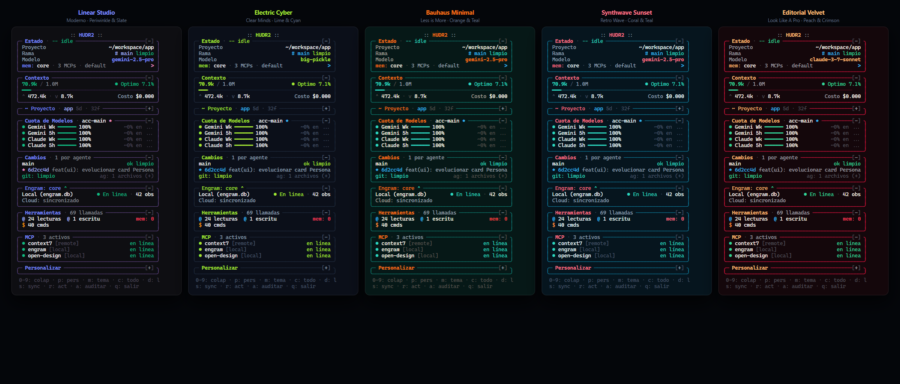
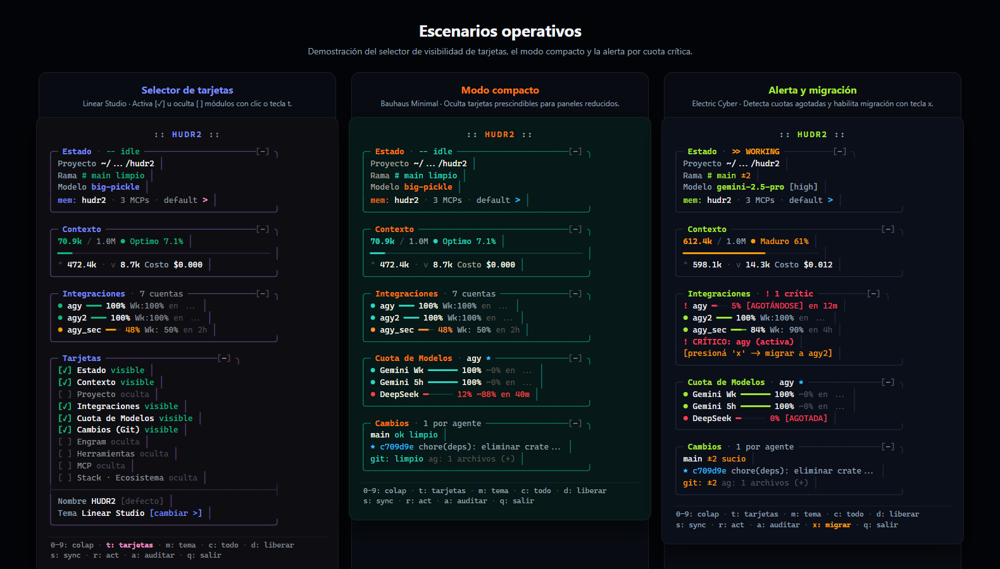

# HUDR2

[](LICENSE)
[](Cargo.toml)
[]()
[]()
[]()

Sidebar de telemetría reactiva en Rust para agentes de código en terminal. Diseñado como panel complementario para **OpenCode**, **Pi / Gentle Shell** y multiplexores de terminal como **Herdr** y **Telar**.

---

## El problema con programar con agentes en terminal

Cuando trabajas con agentes como OpenCode o Gentle Shell dentro de una sesión larga, la información operativa clave suele estar oculta o dispersa:

1. **La ventana de contexto se desborda a ciegas**: No sabes cuántos tokens restan hasta que el modelo empieza a compactar o truncar contexto a mitad de una refactorización compleja.
2. **Las cuotas se agotan sin aviso**: Si trabajas con múltiples cuentas de Cliproxy o proveedores directos (Gemini, Claude, GPT, DeepSeek), una cuenta puede entrar en zona crítica (85%+) y tumbar la tarea sin darte oportunidad de rotar credenciales.
3. **Colisiones entre agentes simultáneos**: Con varios panes o agentes editando el mismo repositorio, es fácil que uno sobreescriba cambios de otro sin que te enteres hasta ejecutar `git status` manualmente.
4. **Barras de estado que devoran CPU**: Monitores tradicionales en Bash o scripts continuos saturan el procesador lanzando subprocesos en bucle cada segundo.

**HUDR2** resuelve esto acoplándose en un split lateral de 48 columnas. Lee directamente los registros de memoria de OpenCode (`opencode.db`), las trazas de streaming de Pi (`.jsonl`), la base de conocimiento de Engram (`engram.db`) y el estado del repositorio local, consumiendo **0% de CPU en reposo**.

---

## Muestra visual

### 1. Colección Cromática

<p align="center">
  
</p>

*5 identidades visuales para terminal:*
1. **Linear Studio:** títulos en Periwinkle (`#7B8AFF`), marco violeta calibrado (`#583F78`), etiquetas Slate Plata (`#94A3B8`) y cursor rosa (`#F095C8`).
2. **Electric Cyber:** títulos y salud en Electric Lime (`#A3E635`), fondo Midnight Navy (`#111827`) y cursor Cyan Neón (`#38BDF8`).
3. **Bauhaus Minimal:** títulos Naranja (`#F97316`), marcos Teal (`#0F766E`) y tipografía marfil cálido (`#FFFBEB`).
4. **Synthwave Sunset:** títulos Coral Pink (`#FB7185`), marcos Ocean Teal (`#0E7490`) y tipografía Ice Blue (`#ECFEFF`).
5. **Editorial Velvet:**  títulos Peach Orange (`#FDBA74`), marcos Crimson Red (`#BE123C`) y lectura Warm Cream (`#FFF7ED`).

### 2. Escenarios Operativos en Vivo

<p align="center">
  
</p>

*Comportamiento reactivo en acción (de izquierda a derecha):*
1. **Gestión de Visibilidad (`Tarjetas`):** Selector interactivo desplegado con atajo `t` o `0`. Permite activar `[✓]` u ocultar `[ ]` cualquier módulo del HUD con un simple clic de ratón. *(Demostrado en Linear Studio)*.
2. **Modo Ultra-Compacto:** Terminal reducida a ~28 líneas esenciales reteniendo únicamente métricas críticas de sesión para espacios de trabajo reducidos. *(Demostrado en Bauhaus Minimal "Less is More")*.
3. **Telemetría Crítica y Migración en Caliente:** Detección en tiempo real de cuentas agotadas (`! [AGOTÁNDOSE]`), desgaste progresivo en ámbar y activación automática del atajo `x: migrar (agy)` para transferir el agente sin interrumpir la tarea. *(Demostrado en Electric Cyber)*.

---

## Qué monitorea HUDR2

| Tarjeta | Origen de datos | Métrica en tiempo real |
|---|---|---|
| **Estado** | `Herdr` / OS | Modo del agente (`idle`, `busy`), proyecto actual, rama activa y modelo seleccionado. |
| **Contexto** | `opencode.db` / Pi Tail | Tokens consumidos vs. tamaño de ventana del modelo, porcentaje restante, tokens I/O y costo acumulado. |
| **Proyecto** | Filesystem | Conteo de directorios y archivos con explorador de árbol desplegable (`o` para abrir en explorador). |
| **Integraciones** | Cliproxy tokens | Porcentaje restante por pool de cuentas, temporizador de reset (`en 4h 59m`) y semáforo dinámico. |
| **Cuota de Modelos** | Cliproxy API | Estado de cuota por familia (Gemini, Claude, GPT, DeepSeek) con métricas de 5h y semanales. |
| **Cambios (Git)** | `.git/HEAD` directo | Líneas agregadas/borradas (`+`/`-`), archivos en staging/worktree y previsualización de diff inline segura. |
| **Engram** | `engram.db` (SQLite) | Observaciones acumuladas, estado del daemon (`7437`) y último handoff de sesión estructurado. |
| **Stack · Ecosistema**| CLI probes | Versiones instaladas de `pi`, `hudr2`, `gentle-shell`, `gentle-ai`, `engram` y `herdr`. |
| **Herramientas** | SQLite / IPC | Llamadas a herramientas en el turno (lecturas, escrituras, comandos bash, engram). |
| **MCP** | IPC / configs | Servidores MCP activos y conectados al entorno. |
| **Tarjetas** | `hudr2.json` | Selector de visibilidad: activa, oculta o fija tarjetas según tus necesidades de espacio. |

---

## Sistema de visibilidad de tarjetas (`Tarjetas`)

Para adaptarse tanto a monitores verticales como a terminales compactas, HUDR2 incluye gestión interactiva de tarjetas:

- Presiona `0` o `t` para desplegar la tarjeta **Tarjetas**.
- Cada fila muestra su estado: `[✓] visible` o `[ ] oculta`.
- Haz clic con el ratón sobre cualquier fila para alternar su visibilidad. Las tarjetas desactivadas desaparecen por completo del flujo de renderizado, permitiendo un HUD ultra-compacto de apenas 30 líneas.
- La tarjeta `Tarjetas` permanece siempre fija (`fija`), evitando cualquier escenario de bloqueo accidental.
- Tus preferencias de visibilidad y colapso se guardan de forma atómica en `hudr2.json`.

---

## Atajos de teclado y ratón

| Tecla / Acción | Efecto |
|---|---|
| `1` – `9` | Plegar o desplegar tarjetas individuales (1: Estado, 2: Contexto, 3: Proyecto, 4: Integraciones, 5: Cuotas, 6: Git, 7: Engram, 8: Herramientas, 9: MCP). |
| `0` o `t` | Plegar o desplegar la tarjeta de **Tarjetas** (selector de visibilidad). |
| `c` | Colapsar o abrir todas las tarjetas a la vez. |
| `x` | **Migración en caliente**: Reasigna sesiones activas con cuota crítica (>85%) hacia la cuenta más saludable disponible. |
| `s` | **Sincronización**: Regenera modelos y templates de Cliproxy en `opencode.json`. |
| `d` | **Liberar**: Cierra sesiones inactivas y limpia retenciones de cuentas en SQLite. |
| `r` | Forzar refresco inmediato de telemetría y cuotas de red. |
| `o` | Abrir la carpeta del proyecto en el explorador de archivos del sistema. |
| `Clic en archivo Git` | Despliega u oculta el diff inline (bloqueando automáticamente claves `.env`, pem y secretos). |
| `k` / `j` o `↑` / `↓` | Desplazar la vista verticalmente. |
| `q` o `Ctrl+C` | Salir de HUDR2. |

---

## Opciones de ejecución

```bash
hudr2 [--once] [--pane <HERDR_PANE_ID>] [--cwd <dir>] [--config <file>]
```

- `--once`: Imprime un snapshot único de las tarjetas activas directamente en stdout y termina de inmediato (ideal para diagnósticos o scripts).
- `--pane <id>`: Vincula el ciclo de vida del HUD a un pane específico de Herdr (se cierra al morir el pane padre).
- `--cwd <dir>`: Ruta del proyecto que se desea monitorear (por defecto toma el directorio actual).
- `--config <file>`: Archivo de configuración alternativo para persistencia de tarjetas.

---

## Instalación y arranque

### Compilar desde fuente
```bash
cargo build --release
```
El binario optimizado quedará en `target/release/hudr2` (o `hudr2.exe` en Windows).

### Lanzar en Linux / macOS
```bash
# Ejecutar en standalone:
./hudr2.sh

# Acoplar automáticamente en split lateral dentro de Herdr:
chmod +x attach-hudr2.sh hudr2.sh
./attach-hudr2.sh
```

### Lanzar en Windows
```cmd
:: Standalone:
hudr2.cmd

:: Acoplar en split lateral de Herdr:
attach-hudr2.cmd
```
*(También se incluyen equivalentes nativos para PowerShell: `hudr2.ps1` y `attach-hudr2.ps1`).*

---

## Rendimiento y arquitectura interna

- **0% CPU en reposo**: HUDR2 implementa un bucle de eventos reactivo. Solo redibuja la pantalla si la instantánea de datos ha variado con respecto al ciclo anterior (`PartialEq` sobre `TelemetrySnapshot`).
- **Git libre de bloqueos**: Ejecuta consultas de Git con `GIT_OPTIONAL_LOCKS=0` y lee `.git/HEAD`, ramas y `packed-refs` directamente del disco sin lanzar subprocesos innecesarios.
- **Captura de ratón button-only**: No inunda la terminal con eventos de movimiento de ratón (`REPORT_MOUSE_POSITION`); solo procesa clics explícitos bajo el estándar SGR.
- **Caché por `mtime`**: La telemetría de OpenCode, Pi y Git solo lee archivos si su fecha de modificación en disco ha cambiado, evitando lecturas redundantes de I/O.
- **Cero crates innecesarios (sin `regex`)**: El análisis de modelos y prefijos opera con helpers nativos de `str` en memoria, reduciendo el tamaño del binario y eliminando la compilación en caliente de autómatas finitos.
- **Escrituras atómicas seguras**: Persistencia de caché y configuraciones protegida con archivos temporales identificados por PID (`.{pid}.tmp`) y renombramiento atómico para evitar corrupción por cierres abruptos o procesos concurrentes.
